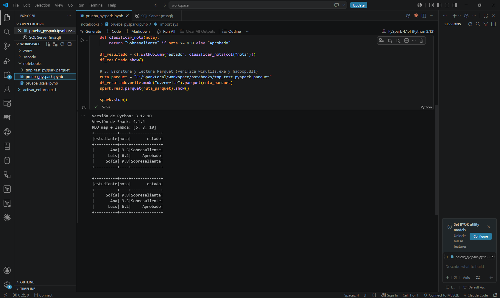
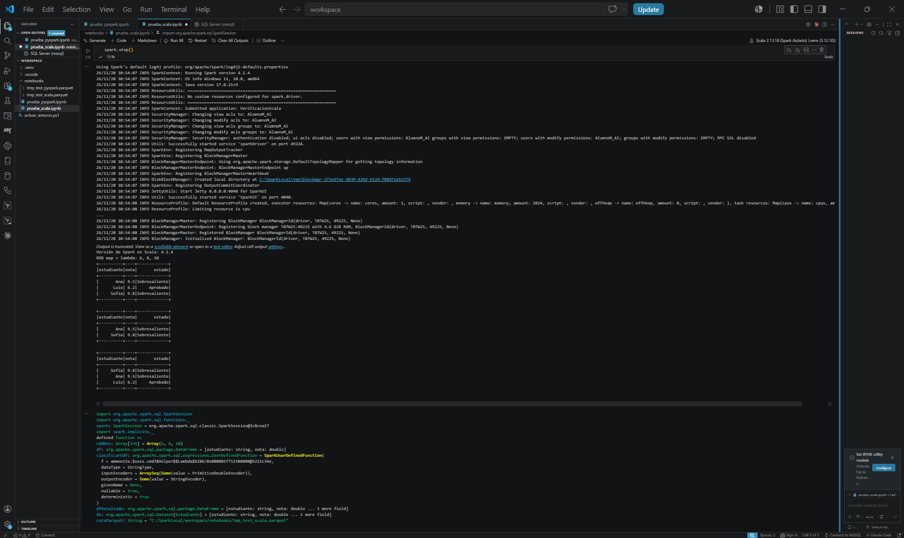
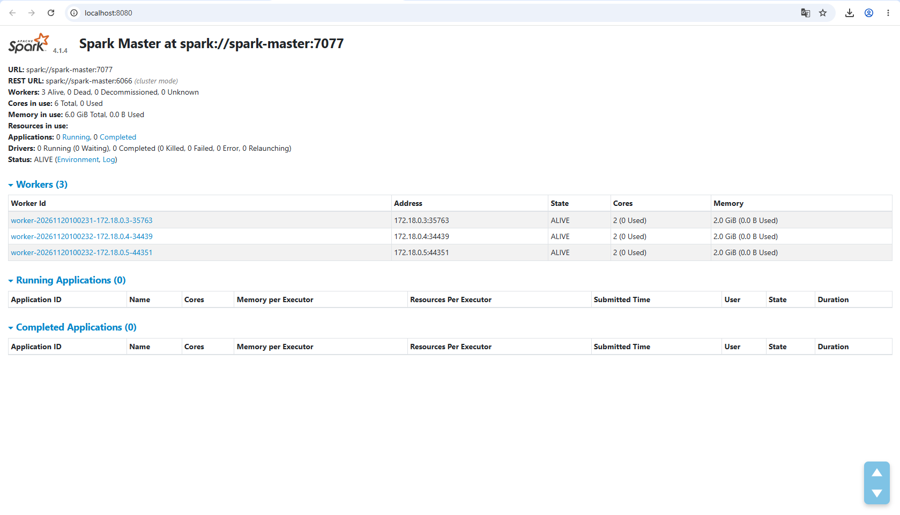
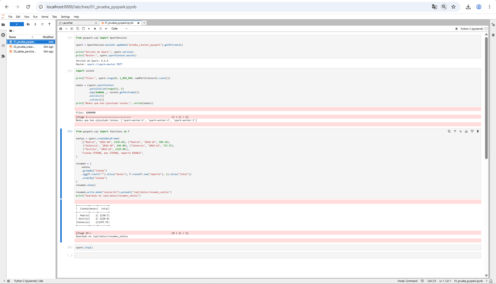

# Instalación de Apache Spark 4.1.4 en Windows: modo local y clúster en Docker

Práctica de instalación de Spark en dos modalidades: un entorno local de un solo nodo con PySpark y Scala, y un clúster simulado con un master y tres workers en contenedores Docker. Este documento recoge cómo quedó montado cada entorno, las comprobaciones realizadas y los problemas encontrados.

## Entorno

| Componente | Versión |
| --- | --- |
| Sistema operativo | Windows 11 (64 bits) |
| Apache Spark | 4.1.4 |
| Java | 17 (Temurin, versión portable) |
| Python | 3.12.10 |
| Scala | 2.13.18 con Almond 0.15.0 (modo local) y 2.13.17 con Almond 0.14.5 (Docker) |
| Docker Desktop | 4.96.3 (Engine 29.9.2, Compose v5.6.1) |

## Parte 1. Spark en local (un nodo)

### Estructura

Toda la instalación vive en `C:\SparkLocal`, sin variables globales de Windows. Las variables de entorno se definen solo en la terminal mediante `activar_entorno.ps1` y en los ficheros `kernel.json` de cada kernel.

```
C:\SparkLocal\
├── jdk-17\          Java 17 portable
├── spark\           binarios de Spark 4.1.4
├── hadoop\bin\     winutils.exe y hadoop.dll
├── tmp\             directorio temporal de Spark
├── tools\           Coursier y cachés
└── workspace\       proyecto de VS Code (.venv, .vscode, notebooks)
```

### Pasos

Los comandos están agrupados en los scripts de la carpeta `instalacion1_local`, que se ejecutaron en este orden:

1. `paso1_estructura.ps1` crea las carpetas.
2. `paso2_3_java_spark_winutils.ps1` descarga Java 17, Spark 4.1.4, `winutils.exe` y `hadoop.dll`.
3. `copiar_a_workspace.ps1` coloca `activar_entorno.ps1`, `.vscode\settings.json` y los notebooks en `C:\SparkLocal\workspace`.
4. `paso5_python_jupyter.ps1` crea el entorno virtual con `py -3.12`, instala `pyspark==4.1.4`, JupyterLab e ipykernel, y registra el kernel `pyspark-414` con sus variables.
5. `paso6_scala.ps1` instala Coursier, el kernel Almond 0.15.0 para Scala 2.13.18 (`scala-213-spark`) y los parámetros de Java 17 necesarios en `JDK_JAVA_OPTIONS`.

### Verificación con PySpark

El notebook `prueba_pyspark.ipynb`, ejecutado con el kernel PySpark 4.1.4 (Python 3.12) desde VS Code, comprueba la versión de Python y Spark, un RDD con `map` y `filter` mediante lambdas, un DataFrame con una UDF y la escritura y lectura de un fichero Parquet. Este último paso valida `winutils.exe` y `hadoop.dll`.



*Figura 1. Salida del notebook de PySpark: Python 3.12.10, Spark 4.1.4, RDD `[6, 8, 10]`, DataFrame con UDF y lectura desde Parquet.*

### Verificación con Scala

El notebook `prueba_scala.ipynb`, con el kernel Scala 2.13.18 (Spark Aislado), repite las mismas pruebas y añade un Dataset tipado con una `case class`. En la figura 2 se ven la versión de Spark, el RDD, el DataFrame con UDF, el Dataset filtrado (solo Ana y Sofía) y los datos leídos desde Parquet. Las líneas `INFO` del inicio corresponden al arranque de la sesión, anterior al ajuste del nivel de log a `WARN`.



*Figura 2. Salida del notebook de Scala en modo local.*

## Parte 2. Clúster Spark en Docker

### Arquitectura

Cinco contenedores creados a partir de una misma imagen, `spark-curso:4.1.4`, para que todos compartan la misma versión de Spark, Java y Python.

| Contenedor | Función | Puertos |
| --- | --- | --- |
| `spark-master` | Master del clúster | 8080 (web), 7077 (clúster) |
| `spark-worker-1`, `-2`, `-3` | Workers de 2 núcleos y 2 GB cada uno | 8081, 8082, 8083 |
| `jupyter` | JupyterLab, donde cada notebook actúa como driver | 8888, 4040, 4041 |

El clúster ofrece 6 núcleos y 6 GB para executors. Cada aplicación pide 3 executors de 1 núcleo y 1 GB, uno por worker. Los notebooks se guardan en `C:\cursos\spark-cluster\notebooks` y los datos en `C:\cursos\spark-cluster\datos`, ambos montados en los contenedores. El catálogo de Hive se guarda en un volumen de Docker.

### Puesta en marcha

Con los ficheros de la carpeta `instalacion2_docker` copiados a `C:\cursos\spark-cluster`:

```powershell
cd "C:\cursos\spark-cluster"
docker compose build
docker compose up -d
docker compose ps
```

### Comprobación del clúster

La interfaz del master en `http://localhost:8080` muestra los tres workers registrados (estado ALIVE, 2 núcleos y 2 GiB cada uno), 6 núcleos y 6 GiB de memoria en total.



*Figura 3. Spark Master con 3 workers activos.*

### Prueba con PySpark sobre el clúster

El notebook `01_prueba_pyspark.ipynb` se ejecutó desde JupyterLab (`http://localhost:8888`). La sesión se conecta a `spark://spark-master:7077` con la configuración de `conf/spark-defaults.conf`. Se cuentan un millón de filas repartidas en seis particiones y se pide a cada tarea el nombre del contenedor donde se ejecuta: aparecen `spark-worker-1`, `spark-worker-2` y `spark-worker-3`, lo que confirma que el trabajo se reparte entre los tres workers. Después se calcula un resumen de ventas por tienda y se guarda en Parquet en `/opt/datos/resumen_ventas`.



*Figura 4. Notebook de PySpark ejecutado en el clúster, con las tareas repartidas entre los tres workers.*

## Incidencias y soluciones

| Problema | Causa | Solución |
| --- | --- | --- |
| El equipo tenía Python 3.12, 3.13 y 3.14 y el `python` por defecto era la 3.14 | La guía fija Python 3.12 | Crear el entorno virtual con `py -3.12 -m venv .venv`, de modo que el `.venv` usa 3.12.10 |
| Los scripts 5 y 6 fallaban al no encontrar `activar_entorno.ps1` | No se había copiado todavía a `C:\SparkLocal\workspace` | Ejecutar `copiar_a_workspace.ps1` antes de los scripts 5 y 6 |
| `toDF` no se reconocía al repetir la celda 3 del notebook de Scala | Almond conserva los imports de la ejecución anterior y chocan con los de la sesión nueva | Reiniciar el kernel y ejecutar las celdas desde la primera |
| `docker version` no conectaba con el servidor | Docker Desktop estaba instalado pero no arrancado | Abrir Docker Desktop y esperar a que el motor estuviera en marcha |
| `docker compose build` fallaba en el paso 7 con `log4j2.properties.template: No such file` | La imagen oficial de Spark 4.1.4 no incluye esa plantilla | Sustituir el `cp` de la plantilla por la creación directa de `/opt/spark/conf/log4j2.properties` en el `Dockerfile` |
| Las celdas del notebook de Jupyter quedaban en `[*]` sin salida | La cola de celdas se había bloqueado mientras arrancaba el kernel | Reiniciar el kernel y ejecutar las celdas una a una |

## Ficheros incluidos

```
README.md
img/                         capturas de las figuras 1 a 4
instalacion1_local/          scripts de instalación, activar_entorno.ps1, settings.json y notebooks de prueba
instalacion2_docker/         Dockerfile, docker-compose.yml, conf/spark-defaults.conf y notebooks
```

El `Dockerfile` incluido ya lleva la corrección del paso 6.
